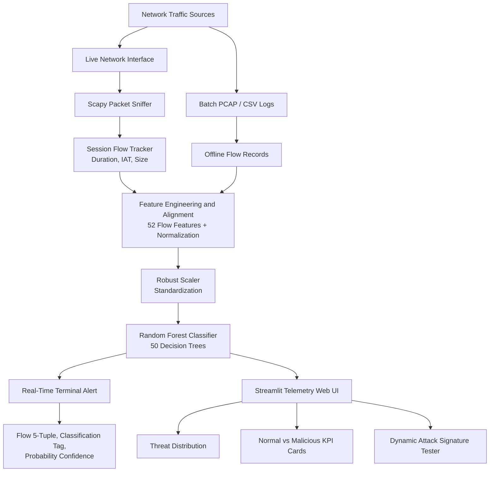

# AI-Powered Network Intrusion Detection System (NIDS)

An intelligent, multi-class Network Intrusion Detection System built using Machine Learning to identify, classify, and monitor cyber threats across enterprise networks. The system combines a high-performance **Random Forest Classifier** trained on the benchmark **CICIDS2017** dataset with a real-time **Scapy** packet capture pipeline and an interactive **Streamlit** threat intelligence dashboard.

## 📌 Executive Summary

Traditional rule-based intrusion detection systems, such as legacy Snort or Suricata rule sets, can struggle with zero-day vulnerabilities, polymorphism, and subtle low-and-slow volumetric anomalies. This project demonstrates an automated, data-driven approach by transforming raw packet captures into bidirectional statistical flows and running inference against a trained ensemble model.

- **Detection Scope:** Multi-class classification across seven traffic profiles: Normal Traffic, DoS, DDoS, Port Scanning, Web Attacks, Brute Force, and Bots.
- **Model Benchmark:** Evaluated on the Canadian Institute for Cybersecurity IDS 2017 dataset, containing approximately 2.8 million records, with approximately **99.90% classification accuracy**.
- **Dual Operation Modes:**
  1.  **Batch Traffic Analysis:** Parses offline flow records and presents visual threat distribution telemetry.
  2.  **Live Packet Ingestion:** Uses Scapy and Npcap to aggregate raw Ethernet frames into stateful flows dynamically.

## 🏛️ System Architecture



### Processing Pipeline

1. Capture live packets or load batch flow records.
2. Track sessions and derive flow-level statistics.
3. Align the input with the 52 verified training features.
4. Standardize features using the serialized scaler.
5. Classify traffic with the serialized Random Forest model.
6. Report the result through terminal alerts or the Streamlit dashboard.

## 📊 Dataset and Feature Engineering

The model is trained on the **CICIDS2017** benchmark, which reflects modern network attacks, realistic background traffic such as HTTP, HTTPS, FTP, SSH, and Email, and deep flow metadata generated through CICFlowMeter.

### Monitored Traffic Categories

| Category       | Attack Sub-Types Included in Benchmark                           |
| -------------- | ---------------------------------------------------------------- |
| Normal Traffic | Benign daily enterprise traffic: Web, Mail, and Cloud sync       |
| DoS            | DoS Hulk, DoS GoldenEye, DoS Slowloris, and DoS Slowhttptest     |
| DDoS           | High-volume LOIC UDP/TCP synchronized flood                      |
| Port Scanning  | Nmap stealth sweeps, SYN scans, and OS fingerprinting            |
| Brute Force    | SSH-Patator and FTP-Patator credential stuffing                  |
| Web Attacks    | Cross-Site Scripting (XSS), SQL Injection, and Command Injection |
| Bots           | Ares botnet command-and-control (C2) communications              |

### Key Flow Features Monitored

The classifier uses 52 statistical flow parameters, including:

- **Temporal Dynamics:** Flow Duration, Flow IAT Mean, Flow IAT Std, Flow IAT Max, Flow IAT Min, Fwd IAT Total, and Bwd IAT Mean.
- **Volumetric Metrics:** Total Fwd Packets, Total Backward Packets, Total Length of Fwd Packets, and Total Length of Bwd Packets.
- **Packet Size Statistics:** Fwd Packet Length Max, Fwd Packet Length Min, Fwd Packet Length Mean, Packet Length Std, and Packet Length Variance.
- **TCP Control Semantics:** FIN Flag Count, SYN Flag Count, RST Flag Count, PSH Flag Count, ACK Flag Count, and URG Flag Count.
- **Window and Subflow Attributes:** Init_Win_bytes_forward, Init_Win_bytes_backward, Subflow Fwd Packets, and Subflow Fwd Bytes.

## 📁 Repository Structure

```text
AI_Intrusion_Detection/
├── data/
│   ├── raw/
│   │   └── cicids2017_cleaned.csv       # Preprocessed benchmark training dataset
│   └── demo_sample_traffic.csv          # Sample CSV for dashboard evaluation
├── models/
│   ├── random_forest_model.pkl          # Serialized Random Forest classifier
│   ├── scaler.pkl                        # Scikit-learn feature scaler
│   ├── label_encoder.pkl                 # Target class label encoder
│   └── feature_names.pkl                 # 52-feature column mapping
├── notebooks/
│   └── 01_data_exploration.ipynb         # Dataset exploration notebook
├── src/
│   ├── app.py                            # Streamlit telemetry web application
│   ├── live_detector.py                  # Real-time packet sniffer and classifier
│   ├── sniffer.py                        # Lightweight packet inspection utility
│   ├── simulate_dos.py                   # UDP flood stress-testing utility
│   └── test_attack_detection.py          # Ground-truth signature verification
├── requirements.txt                      # Python dependencies
└── readme.md                             # Project documentation
```

## ⚙️ Installation and Setup

### Prerequisites

- **Operating System:** Windows 10/11, Ubuntu 20.04+, or macOS.
- **Python Runtime:** Python 3.10 to 3.12.
- **Hardware Drivers for live capture:** [Npcap](https://npcap.com/) on Windows or `libpcap` on Linux.
- **Privileges:** Administrator/root privileges may be required for live packet capture.

### 1. Clone and Set Up the Virtual Environment

#### PowerShell

```powershell
# Clone the repository
git clone https://github.com/your-username/AI_Intrusion_Detection.git
Set-Location AI_Intrusion_Detection

# Initialize the virtual environment
python -m venv venv

# Activate it on Windows PowerShell
.\venv\Scripts\Activate.ps1
```

#### Linux / macOS

```bash
git clone https://github.com/your-username/AI_Intrusion_Detection.git
cd AI_Intrusion_Detection
python3 -m venv venv
source venv/bin/activate
```

### 2. Install Required Dependencies

```powershell
python -m pip install --upgrade pip
pip install -r requirements.txt
```

## 🚀 Execution and Operational Modes

### Mode 1: Interactive Telemetry Dashboard (Recommended)

Launches the browser-based security operations dashboard with batch analysis, attack signature evaluation, and model metadata.

```powershell
streamlit run src\app.py
```

Open [http://localhost:8501](http://localhost:8501) in a browser.

#### Dashboard Workflows

- **Attack Signature Tester:** Select `Sample & Evaluate Attacks` to evaluate one representative sample from every attack class in the dataset.
- **Batch Traffic Analysis:** Upload `data/demo_sample_traffic.csv` to review classification metrics, KPI counters, threat distribution, and the first 50 classified records.
- **Model Details:** Inspect the algorithm, accuracy claim, monitored feature count, detection scope, and registered feature names.

### Mode 2: Live Network Packet Sniffing

Captures live frames from the physical network adapter, groups them into session flows, and performs real-time classification.

Run this from an **Administrator PowerShell** prompt on Windows:

```powershell
python src\live_detector.py
```

Press `Ctrl+C` to stop monitoring. Alerts include the timestamp, protocol, source and destination addresses, destination port, and predicted attack label.

### Mode 3: Ground-Truth Attack Verification

Validates that the serialized machine learning model identifies representative samples from every signature class without relying on external network traffic.

```powershell
python src\test_attack_detection.py
```

Expected output format:

```text
=================================================================
ACTUAL ATTACK TYPE    | AI PREDICTION         | STATUS
=================================================================
Bots                  | Bots                  | PASS (MATCH)
Brute Force           | Web Attacks           | MISMATCH
DDoS                  | DDoS                  | PASS (MATCH)
DoS                   | DoS                   | PASS (MATCH)
Normal Traffic        | Normal Traffic        | PASS (MATCH)
Port Scanning         | Port Scanning         | PASS (MATCH)
Web Attacks           | Web Attacks           | PASS (MATCH)
=================================================================
```

### Mode 4: Synthetic Attack Generation (Stress Testing)

Generates high-frequency UDP socket traffic to stress-test the capture engine against volumetric denial-of-service signatures.

```powershell
python src\simulate_dos.py
```

The utility sends 5,000 UDP packets to `8.8.8.8` on port `80` from local port `44444`. Use only in an authorized test environment and ensure that generating this traffic is permitted by your network policy.

## 🔬 Performance and Limitations Analysis

### Bidirectional Flow Extraction Trade-Off

- **Offline Batch Analysis:** Achieves approximately 99.90% accuracy because every record contains all 52 bidirectional statistical dimensions, including inter-arrival times, backward packet intervals, and window sizing.
- **Live Ingestion Bottleneck:** Real-time Python packet parsing via Scapy captures single-direction packets immediately, but calculating complex backward-flow statistics on the fly requires multi-threaded connection-table management. Features missing in lightweight live capture can cause predictions to favor benign baselines.
- **Production Recommendation:** High-throughput production deployments should decouple flow assembly from model inference by pairing a dedicated C++ flow collector, such as CICFlowMeter or IPFIX/NetFlow probes, with an asynchronous inference service such as FastAPI and Redis Queue.

## 🧪 Testing and Validation

The repository includes a zero-shot signature verification script. Before testing, confirm that the following serialized artifacts exist in `models/`:

- `random_forest_model.pkl`
- `scaler.pkl`
- `label_encoder.pkl`
- `feature_names.pkl`

For dashboard testing, use `data/demo_sample_traffic.csv`. For live-capture testing, install Npcap, open an elevated terminal, and stop the process with `Ctrl+C` when finished.

## 🔐 Responsible Use

This project is intended for defensive security research, education, and authorized testing. Do not run packet capture or synthetic traffic generation against networks, hosts, or services without explicit permission.
